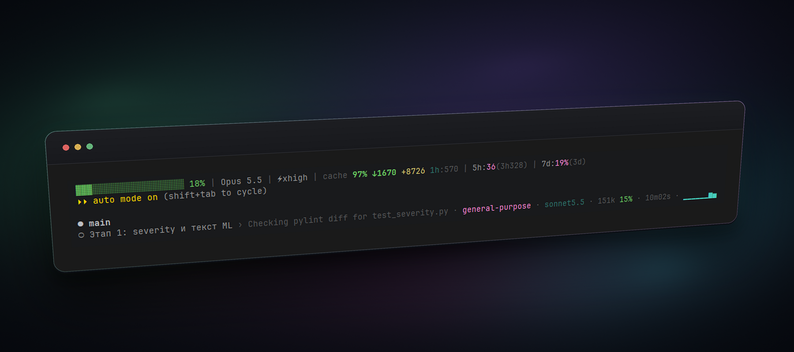

# claude-statusline



Статуслайн для [Claude Code](https://code.claude.com): заполнение контекста, модель, состояние prompt cache, лимиты и отдельные строки для запущенных субагентов. Два Node.js-скрипта без зависимостей.

## Возможности

### Основная строка — `statusline.js`

```
▓▓▓░░░░░░░ 18% | Opus 5.5 | ⚡xhigh·fast | 🌳feature | cache 97% ↓1.7k +8.7k 1h:56m | 5h:36%(3h28m) | 7d:19%(3d)
```

- **Контекст** — полоса `▓░` и процент заполнения окна: зелёный, жёлтый с 60%, красный с 80%.
- **Модель, effort и fast mode** — имя модели, `⚡уровень` reasoning effort и оранжевая метка `fast`, когда включён fast mode. Метка остаётся даже в самом узком терминале.
- **Worktree** — `🌳имя`, если сессия запущена в git worktree.
- **Prompt cache**:
  - доля попаданий в кэш;
  - токены последнего запроса: `↓` прочитано из кэша, `+` записано в кэш;
  - TTL (`5m`/`1h`) с обратным отсчётом до истечения, `cold`, если кэш остыл;
  - `❄N` — сколько токенов придётся заново закэшировать, если кэш остынет;
  - `✗N:причина` — число промахов и причина последнего (`tools+1`, `sys+2k`, `ttl5m`, `srv`); свежий промах подсвечивается красным;
  - `cache:reset` после `/compact`.
- **Лимиты** — расход 5-часового и недельного лимитов с временем до сброса.
- **Адаптивная ширина** — строка укладывается в `$COLUMNS`: в узком терминале детали убираются по одной, от наименее важных (счётчики кэша, полное имя модели, ширина полосы, время сброса и т. д.).

### Строки субагентов — `subagent-statusline.js`

```
Этап 1: severity › Checking pylint diff · general-purpose · 🌳agent-a1b2 · sonnet5.5 · 151k 15% · 10m02s · ▁▃▆▇██
```

- **Статус** — у работающего агента иконки нет; `✓` готово, `✗` ошибка, `■` остановлен, `…` в очереди.
- **Задача** — название и текущий шаг агента (шаг приглушён).
- **Тип агента** — у каждого типа свой стабильный цвет, так строки одного типа читаются группой.
- **Worktree** — `🌳имя`, если субагент работает в своей директории, например в изолированном worktree. Колонка появляется, только когда такой агент есть.
- **Модель и effort** — в коротком виде (`opus5.5`, `haiku4.5`).
- **Токены, % контекста и время работы** (время — только у работающих агентов).
- **Активность** — спарклайн прироста токенов за последние тики: простаивающий агент выглядит плоской линией.
- **Выравнивание по колонкам** между строками; в узком терминале сначала скрываются спарклайн, время, модель, worktree и тип агента.

## Требования

- Claude Code с поддержкой `statusLine`. Блок prompt cache появляется начиная с версии 2.1.251, тип агента в строках субагентов — с 2.1.293.
- Node.js 18+.
- Терминал с поддержкой truecolor и Unicode.

## Установка

### Вручную

1. Скачайте скрипты в `~/.claude/`:

   ```bash
   curl -fsSL https://raw.githubusercontent.com/versus666jzx/claude-statusline/main/statusline.js -o ~/.claude/statusline.js
   curl -fsSL https://raw.githubusercontent.com/versus666jzx/claude-statusline/main/subagent-statusline.js -o ~/.claude/subagent-statusline.js
   ```

2. Добавьте в `~/.claude/settings.json`, не трогая остальные ключи:

   ```json
   {
     "statusLine": {
       "type": "command",
       "command": "node ~/.claude/statusline.js",
       "refreshInterval": 5
     },
     "subagentStatusLine": {
       "type": "command",
       "command": "node ~/.claude/subagent-statusline.js"
     }
   }
   ```

   `refreshInterval` перерисовывает строку раз в 5 секунд, чтобы обратные отсчёты TTL и лимитов шли без новых сообщений.

3. Перезапустите Claude Code.

### С помощью агента

Вставьте в Claude Code:

```text
Установи статуслайн из https://github.com/versus666jzx/claude-statusline:
1. Скачай statusline.js и subagent-statusline.js в ~/.claude/. Если такие файлы уже есть, сначала сохрани их копии с суффиксом .bak.
2. В ~/.claude/settings.json добавь или замени ключи statusLine и subagentStatusLine так, как указано в README репозитория. Остальные настройки не трогай.
3. Проверь скрипт: передай в node ~/.claude/statusline.js тестовый JSON с полями model.display_name и context_window.used_percentage и покажи вывод.
```
